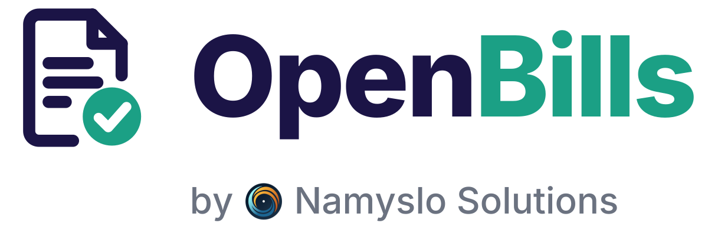
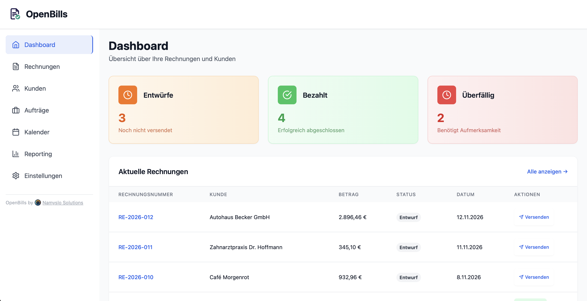
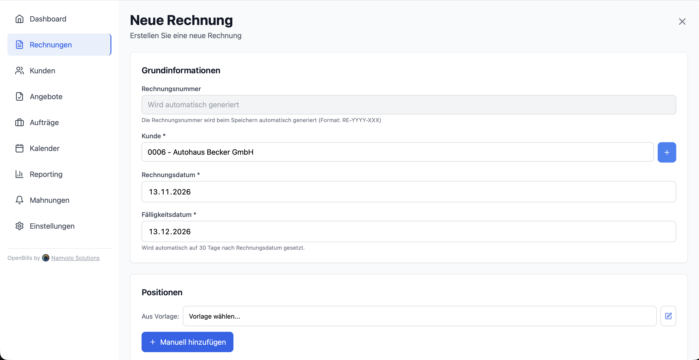
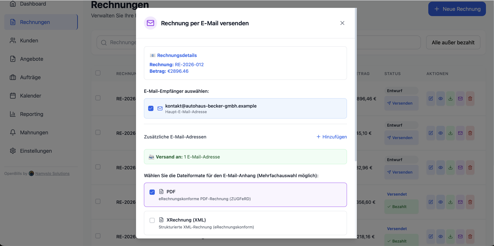
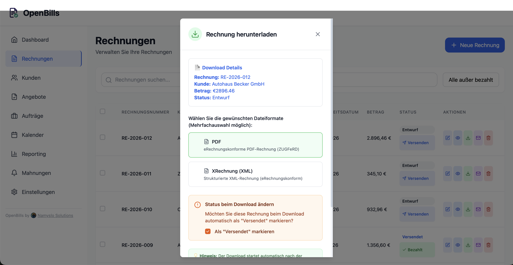
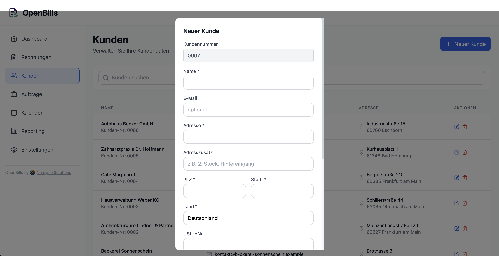
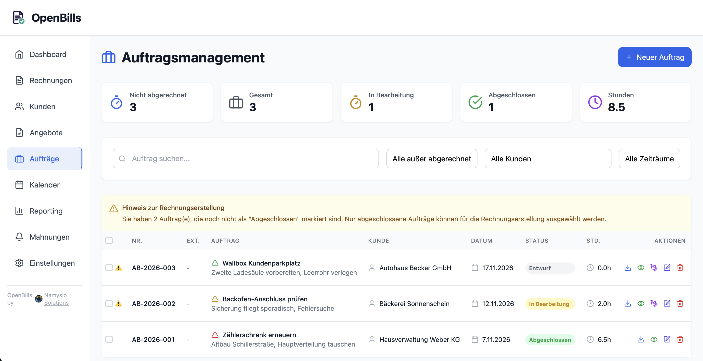
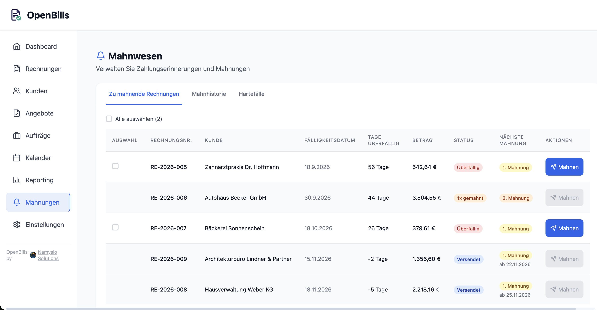
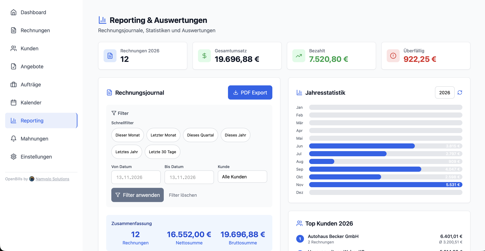

<div align="center">
  <picture>
    <source media="(prefers-color-scheme: dark)" srcset="backend/assets/OpenBills_by_NamysloSolutions_dark.png">
    
  </picture>

  **[openbills.de](https://openbills.de)**
</div>

# Moderne Rechnungssoftware für KMU, Handwerk & Dienstleister

> Leistungsstarke, eRechnung-konforme Rechnungs- und Angebotssoftware mit Auftragsverwaltung, Zeiterfassung, Mahnwesen, E‑Mail‑Versand und Backup – entwickelt für den deutschen Markt.

[](https://www.gnu.org/licenses/agpl-3.0)
[](https://github.com/jnamyslo/OpenBills)
[](https://docker.com)
[](https://nodejs.org)
[](https://reactjs.org)
[](https://postgresql.org)
[](#-responsive-design)

**🚀 Vollständig containerisiert • 📱 Mobile‑First • 🔒 GoBD/DSGVO‑geeignet • 🌍 Multi‑Instanz**

---

## 🔎 Warum OpenBills?

OpenBills ist eine praxisnahe, in Deutschland entwickelte Open‑Source‑Rechnungssoftware. Sie deckt den kompletten Prozess von Angebot über Auftrag/Zeiterfassung bis zur Rechnung inkl. eRechnung (ZUGFeRD/XRechnung), Versand per E‑Mail, Mahnwesen und Backups ab. Ideal für KMU, Startups, Handwerksbetriebe und Freelancer.

Suchbegriffe (SEO): Rechnungssoftware, Rechnungsprogramm, eRechnung, ZUGFeRD, XRechnung, GoBD, Mahnwesen, Angebote, Auftragsverwaltung, Zeiterfassung, Handwerk, KMU, PostgreSQL, Docker.

---

## 🌟 Funktionsumfang

### 📄 Rechnungen
- **Erstellung und Bearbeitung** mit anpassbaren Positionen, Rabatten (Position & global)
- **Automatische Rechnungsnummerierung** (jährlich mit Startwerten je Jahr)
- **Anhänge** (PDF/Dokumente) pro Rechnung
- **E‑Mail‑Versand** direkt aus der App (SMTP, mehrere Empfänger)
- **Status & Fälligkeit**: Entwurf, versendet, bezahlt, überfällig, inkl. Mahnstufen
- **Export-Formate**: Standard PDF, **ZUGFeRD 2.1** (PDF/A‑3 + XML), **XRechnung 3.0** (XML)

### 💼 Angebote (optional)
- Angebote mit Gültigkeitsdatum, Status‑Workflow (Entwurf → Versendet → Angenommen/Abgelehnt/Abgelaufen)
- PDF‑Export, E‑Mail‑Versand, Anhänge
- Ein‑Klick‑Konvertierung von Angebot → Rechnung

### 👥 Kundenverwaltung (CRM)
- Vollständige Kundendaten inkl. **mehrerer E‑Mail‑Adressen**
- Kundenspezifische **Stundensätze** und **Materialien**

### 🛠️ Aufträge & Zeiterfassung (optional)
- Jobbasierter Workflow mit Status (Entwurf, in Bearbeitung, abgeschlossen, abgerechnet)
- Mehrere Zeiteinträge pro Job, Materialien, Notizen, Anhänge
- **Digitale Unterschrift** für Abnahmen (Signatur-Pad)

### ⏰ Mahnwesen (Payment Reminders) (optional)
- Mahnstufen 1–3 inkl. Gebühren, Texte und Historie
- Versand per E‑Mail (PDF‑Mahnungen), Tracking von letzter Mahnung und max. Stufe

### 📊 Reporting (optional)
- Journal/Export mit Zeitraum‑ und Kundenfilter
- Summen (Netto, Steuer, Brutto), Statusverteilung, Kunden‑Toplisten

### 🏢 Unternehmensanpassung
- Firmenprofil mit **Logo, Icon, Farben, zwei‑zeiligem Kopfbereich**
- IBAN/BIC & getrennte **Zahlungsinformationen** (Kontoinhaber, Bank, Zahlungsbedingungen, -methoden)
- Kleinunternehmer‑Option (§19 UStG)

### 🔁 Multi‑Instanz & Backups
- Beliebig viele Mandanten auf einem Server (getrennte Datenbanken/Ports)
- **Vollbackups (ZIP)**, verschlüsselt mit Backup‑Passwort, inkl. Anhängen und Metadaten

---

## 📸 Screenshots & Einblicke

Erleben Sie OpenBills in Aktion – hier sind einige Einblicke in die Benutzeroberfläche:

### Dashboard & Übersicht
<div align="center">
  
  <p><em>Übersichtliches Dashboard mit allen wichtigen Kennzahlen, überfälligen Rechnungen und Schnellzugriffen</em></p>
</div>

### Rechnungsverwaltung
<div align="center">
  
  <p><em>Intuitiver Rechnungseditor mit Drag & Drop, Live-Vorschau und Rabatten auf Positions- und Gesamtebene</em></p>
</div>

<div align="center">
  
  <p><em>E-Mail-Versand mit ZUGFeRD/XRechnung-Unterstützung, mehreren Empfängern und individuellen Anhängen</em></p>
</div>

<div align="center">
  
  <p><em>Multi-Format-Export: Standard-PDF, ZUGFeRD 2.1 und XRechnung 3.0 – alles mit einem Klick</em></p>
</div>

### Kundenverwaltung & CRM
<div align="center">
  
  <p><em>Vollständige Kundenverwaltung mit mehreren E-Mail-Adressen, kundenspezifischen Stundensätzen und Materialien</em></p>
</div>

### Auftrags- & Zeiterfassung
<div align="center">
  
  <p><em>Professionelles Auftragsmanagement mit Zeiterfassung, Materialien, Status-Tracking und digitaler Unterschrift</em></p>
</div>

### Mahnwesen
<div align="center">
  
  <p><em>Automatisiertes Mahnwesen mit 3 Mahnstufen, konfigurierbaren Gebühren und E-Mail-Versand</em></p>
</div>

### Reporting & Auswertungen
<div align="center">
  
  <p><em>Umfassende Auswertungen mit Zeitraum-Filtern, Umsatzstatistiken und Kunden-Toplisten</em></p>
</div>

---

## 🇩🇪 eRechnung & Compliance

### Unterstützte Standards
- EN 16931, **ZUGFeRD 2.1**, **XRechnung 3.0**, PEPPOL BIS Billing 3.0, UBL 2.1, UN/CEFACT CII

### Validierung & Qualität
- Automatische Struktur‑ und Regelprüfungen, KOSIT‑konforme Generierung, PDF/A‑3 für Langzeitarchivierung

### Recht & Datenschutz
- GoBD‑geeignete Arbeitsweise, DSGVO‑freundlich (Self‑Hosting, lokale Daten), AO‑konforme Archivierung möglich

---

## 🔧 Systemanforderungen

### Minimal
- Docker 20.10+ und Docker Compose 2.0+
- RAM: 2 GB (4 GB empfohlen)
- Speicher: 5 GB (mehr für Backups)
- CPU: 2 Kerne (4+ empfohlen)
- OS: Linux, macOS, Windows (WSL2)

### Produktion (Empfehlung)
- RAM 8 GB+, Speicher 50 GB+, stabile Internetverbindung für E‑Mail

---

## 🚀 Installation & Quickstart

### Multi‑Instanz Setup

```bash
git clone https://github.com/jnamyslo/OpenBills.git
cd OpenBills
```

Interaktiv (empfohlen):
```bash
./deploy-instance.sh
```
Was passiert:
- Instanzname, Port‑Erkennung, Tarif‑Auswahl, öffentliche URL, sichere Passwörter, Konfigurationstest
- Nach dem Start: Ausgabe von Support‑Zugang und Onboarding‑Link (siehe „Anmeldung & Nutzer“)

Schnell‑Deployment (ohne E‑Mail‑Setup):
```bash
./deploy-instance.sh --legacy client1 5432 3001 8080 [tarif] [url]
#                           ^name   ^db   ^api ^web  ^optional, siehe „Tarife“ ("" = überspringen)
#                                                          ^öffentliche URL, Standard http://localhost:<web>
```

# Zugriff
# Frontend: http://localhost:8080

Beispiel‑Portschema:

| Instanz | DB | API | Web | URL |
|---|---:|---:|---:|---|
| client1 | 5432 | 3001 | 8080 | http://localhost:8080 |
| client2 | 5433 | 3002 | 8081 | http://localhost:8081 |
| client3 | 5434 | 3003 | 8082 | http://localhost:8082 |

DB- und API-Port sind nur an `127.0.0.1` gebunden (von außen nicht erreichbar). Öffentlicher Einstieg ist ausschließlich der Web-Port; Nginx leitet `/api` intern an das Backend weiter. Remote-Zugriff auf DB/API bei Bedarf per SSH-Tunnel, z. B. `ssh -L 5432:127.0.0.1:5432 <host>`.

### Instanzen verwalten

```bash
./manage-instances.sh --help
./manage-instances.sh list
./manage-instances.sh start client1
./manage-instances.sh stop client1
./manage-instances.sh restart client1
./manage-instances.sh logs client1 [backend]
./manage-instances.sh backup client1
./manage-instances.sh config client1
./manage-instances.sh onboarding-link client1   # neuer Onboarding-Link
./manage-instances.sh operator-reset client1    # Support-Zugang (neu) anlegen
./manage-instances.sh remove client1   # ⚠️ löscht Daten
```

`list` zeigt pro Instanz Status, Tarif, öffentliche URL und Ports.

---

## 🔐 Anmeldung & Nutzer

OpenBills hat eine eigene Anmeldung (E‑Mail + Passwort, optional 2FA); ein vorgeschalteter Identity‑Provider ist nicht nötig.

- **Onboarding:** Beim Deployment wird ein Onboarding‑Link (`<PUBLIC_URL>/#setup/<token>`, 48 h gültig, einmalig) ausgegeben. Der Kunde legt darüber den ersten Admin an. Neuer Link: `./manage-instances.sh onboarding-link <name>` (nur solange noch kein Kunden‑Admin existiert).
- **Support‑Zugang:** `support@openbills.de` (Rolle Admin) wird beim Deployment mit zufälligem Passwort angelegt; Zugangsdaten werden einmalig ausgegeben und gehören in den Passwortmanager. Neues Passwort (setzt Sessions und 2FA des Zugangs zurück): `./manage-instances.sh operator-reset <name>`.
- **Rollen:** `admin` (Einstellungen, Nutzerverwaltung, Audit‑Log) und `user` (Tagesgeschäft ohne Einstellungen).
- **Nutzer:** Admins laden Nutzer per Einladungslink ein (48 h gültig), ändern Rollen, deaktivieren Nutzer und setzen 2FA zurück.
- **2FA:** TOTP per Authenticator‑App (QR‑Code) mit 10 Recovery‑Codes; für Admins empfohlen.
- **Passwort vergessen:** Reset‑Link per E‑Mail bzw. durch einen Admin erzeugt (1 h gültig, einmalig).
- **Audit‑Log:** Anmeldungen und Änderungen werden protokolliert und 90 Tage aufbewahrt (Einstellungen → Audit‑Log).
- **Backups:** Nutzerdaten sind nicht Teil des App‑Backups und werden beim Restore nicht angefasst. Vollständige Sicherung inkl. Nutzern: `./manage-instances.sh backup <name>` (DB‑Dump).

Wichtige Backend‑Variablen in `.env.backend.<name>`: `PUBLIC_URL`, `AUTH_ENCRYPTION_KEY` (32 Byte base64, nicht ändern/verlieren, sonst sind hinterlegte 2FA‑Secrets unbrauchbar), `TRUST_PROXY_HOPS`.

**Netzwerk (wichtig):** Die Instanz‑Ports (Web, API, DB) dürfen von außen nie erreichbar sein. Offen sind nur 80/443 der vorgelagerten Proxy‑Firewall, über den Nginx Proxy Manager (NPM). Von Docker veröffentlichte Ports umgehen `ufw`; eine Host‑Firewall allein schützt sie also nicht. `TRUST_PROXY_HOPS=2` (Standard) setzt NPM vor dem Frontend‑Nginx voraus. Ist der Web‑Port direkt erreichbar, lässt sich `X-Forwarded-For` fälschen und damit das Rate‑Limit pro IP umgehen.

### Umstellung von Authentik

Bestehende Instanzen (bisher Authentik + NPM Forward‑Auth) werden in‑place umgestellt:

1. Backup erstellen (`./manage-instances.sh backup <name>`).
2. `PUBLIC_URL` (z. B. `https://kunde.openbills.de`) und `AUTH_ENCRYPTION_KEY` (`openssl rand -base64 32`) per `./manage-instances.sh config <name>` in `.env.backend.<name>` ergänzen, `git pull`, Instanz neu starten. Die Migration legt leere Auth‑Tabellen an, Fachdaten bleiben unverändert.
3. `./manage-instances.sh operator-reset <name>` und `./manage-instances.sh onboarding-link <name>` ausführen; den Link an den Kunden senden.
4. Authentik bleibt bis zum Abschluss des Onboardings vor der Instanz. Danach Forward‑Auth im NPM entfernen.

- Die URL im Browser muss exakt `PUBLIC_URL` entsprechen. Die Origin‑Prüfung lehnt andere Hosts oder Aliase (z. B. IP, zweite Domain) ab.
- `backups/` enthält neben dem DB‑Dump auch `.env.backend.<name>` inkl. `AUTH_ENCRYPTION_KEY`. Das Verzeichnis daher geschützt ablegen (Zugriffsrechte, verschlüsselter Speicher).

Zwischen Schritt 2 und dem Onboarding ist die API geschlossen (ohne Session 401).

Hinweis: `scripts/seed-demo.mjs` funktioniert ohne Login nicht mehr (die API verlangt eine Session).

---

## 💳 Tarife (Managed SaaS)

Self‑Hosted‑Instanzen haben **immer den vollen Funktionsumfang ohne Limits**. Tarife sind nur für betriebene (Managed‑SaaS‑)Instanzen gedacht und werden pro Instanz in `.env.backend.<name>` gesetzt:

```bash
OPENBILLS_PLAN=starter                          # free | starter | professional | enterprise; leer = self-hosted
OPENBILLS_UPGRADE_CONTACT=vertrieb@example.com  # E-Mail, Telefon oder URL im Upgrade-Hinweis
```

`deploy-instance.sh` fragt beides ab. Nachträglich ändern: `./manage-instances.sh config <name>`, danach `./manage-instances.sh restart <name>`. Ein unbekannter Wert in `OPENBILLS_PLAN` verhindert den Start des Backends (kein stilles „unbegrenzt“ bei Tippfehlern).

| | Free | Starter | Professional | Enterprise |
|---|---:|---:|---:|---:|
| Rechnungen / Monat | 5 | 25 | 100 | ∞ |
| Angebote / Monat | 5 | 25 | 100 | ∞ |
| Kunden (gesamt) | 10 | 50 | 250 | ∞ |
| PDF, XRechnung, ZUGFeRD, Backup | ✓ | ✓ | ✓ | ✓ |
| E‑Mail‑Versand, Mahnwesen | – | ✓ | ✓ | ✓ |
| Aufträge & Zeiterfassung | – | – | ✓ | ✓ |
| Kundenspez. Stundensätze, Materialvorlagen | – | – | ✓ | ✓ |
| Reporting | Basis | Basis | voll | voll |

**Zählregeln**
- Eine Rechnung bzw. ein Angebot zählt **einmal**, sobald es den Entwurfsstatus verlässt (z. B. beim Versand). Entwürfe sind unbegrenzt.
- Löschen gibt kein Kontingent zurück. Abrechnungsmonat ist der Kalendermonat der Freigabe (deutsche Zeit).
- Am Limit wird die Freigabe abgelehnt; die App zeigt einen Upgrade‑Hinweis mit dem hinterlegten Kontakt.
- Nach einem Downgrade bleiben bestehende Daten erhalten; gesperrt werden nur neue Freigaben und nicht enthaltene Funktionen.

**Entwürfe** tragen in Vorschau und Download (in allen Instanzen, auch self‑hosted) das Wasserzeichen „ENTWURF“ und lassen sich nicht als XRechnung oder mit eingebettetem ZUGFeRD exportieren. Beim E‑Mail‑Versand oder Download mit „als versendet markieren“ wird der Entwurf vorher freigegeben, der Empfänger erhält ein fertiges Dokument.

Details: [`docs/superpowers/specs/2026-11-13-plan-tiers.md`](docs/superpowers/specs/2026-11-13-plan-tiers.md)

---

## ✉️ E‑Mail & SMTP

- SMTP‑Einstellungen in der App pflegbar (DB‑gestützt), Test‑Verbindung, Test‑E‑Mail
- Versand von Rechnungen/Angeboten/Mahnungen inkl. Anhängen, mehrere Empfänger, Vorlagentexte
- E‑Mail‑Historie mit Status, Fehlern, Statistik und Suche

Beispiele (typische Provider):

| Provider | Host | Port | Verschlüsselung |
|---|---|---:|---|
| Gmail | smtp.gmail.com | 587 | STARTTLS |
| Outlook | smtp-mail.outlook.com | 587 | STARTTLS |
| T‑Online | securesmtp.t-online.de | 465 | SSL/TLS |

---

## 💾 Backups & Restore

- Voll‑Backups als ZIP (alle Fachdaten inkl. Anhängen + Metadaten)
- Daten im ZIP mit einem beim Erstellen vergebenen Backup‑Passwort verschlüsselt (AES‑256‑GCM, scrypt). Das Passwort wird nicht gespeichert – ohne Passwort keine Wiederherstellung. Ältere, unverschlüsselte ZIP‑Backups lassen sich weiterhin einspielen.
- Download/Upload/Restore direkt in der App (mit Kompatibilitäts‑Fixes), Upload bis 500 MB

### Umzug von Belego

OpenBills hieß früher Belego. Container, Volumes, Datenbanken und Env-Variablen tragen jetzt `openbills` im Namen; bestehende Belego-Instanzen werden **nicht** automatisch übernommen. Ein reines `git pull` + `./manage-instances.sh restart <name>` auf einer alten Instanz wird **nicht** unterstützt (Instanz läuft zwar weiter, aber `list`/`backup` finden sie nicht mehr und ein Tarif aus `BELEGO_PLAN` greift nicht). Umzug per Backup/Restore (kurze Downtime, gleiche Ports):

1. Alte Instanz auf den letzten Belego-Stand bringen, dann in der App **Einstellungen → Backup → Vollbackup** herunterladen. Ab jetzt keine Änderungen mehr in der alten Instanz.
2. Eigene Werte aus `.env.backend.<name>` notieren (SMTP, Tarif, Upgrade-Kontakt …).
3. Alte Instanz stoppen: `docker compose --env-file .env.<name> -f docker-compose.yml stop`
4. Neuen Code holen und `./deploy-instance.sh` (interaktiv) mit gleichem Instanznamen und den bisherigen Ports ausführen. Notierte Werte in die neue `.env.backend.<name>` übertragen – `BELEGO_PLAN` heißt jetzt `OPENBILLS_PLAN`, `BELEGO_UPGRADE_CONTACT` heißt `OPENBILLS_UPGRADE_CONTACT`. **Alte `BELEGO_*`-Variablen werden nicht mehr gelesen** (die Instanz liefe sonst als Self-Hosted ohne Limits). Danach `./manage-instances.sh restart <name>`.
5. In der neuen Instanz das Backup wiederherstellen und prüfen. Das Backup bringt das bisherige Firmenlogo/-icon mit – war das noch das Belego-Standardlogo, unter **Einstellungen** durch das eigene oder das OpenBills-Logo (`backend/assets/OpenBills.png`, `OpenBills_Icon.png`) ersetzen.
6. Alte Reste entfernen (`manage-instances.sh` kennt nur noch `openbills-*`):
   ```bash
   docker rm belego-<name>-frontend belego-<name>-backend belego-<name>-db
   docker volume rm belego-<name>_postgres_data
   docker network rm belego-<name>_network
   ```

Zurück: neue Instanz stoppen, alte Container wieder starten (`docker start belego-<name>-db belego-<name>-backend belego-<name>-frontend`).

---

## 📱 Responsive Design

- Mobile‑First, Touch‑optimiert, Safe‑Area‑Support
- Adaptive Listen/Tabellen, Kartenansichten, große Touch‑Targets

---

## 🏗️ Architektur

### Frontend
- React 18 + TypeScript, Vite, Tailwind CSS, Context API

### Backend
- Node.js (Express), PostgreSQL
- Datei‑Uploads (Multer), strukturierte Logs

### Deployment
- Docker & Docker Compose, optional Nginx
- Healthchecks, automatisierte Backups

---

## 📊 Roadmap (Auszug)

Bereits umgesetzt:
- eRechnung (ZUGFeRD/XRechnung), Multi‑Format‑Export
- Angebote (optional), Mahnwesen, E‑Mail‑Management
- Kunden‑spezifische Sätze/Materialien, digitale Unterschriften
- Reporting/Journal, Multi‑Instanz, Responsive UI, Backups

Geplant:
- Automatische Backup‑Zyklen, Massenversand, Integrations‑API, Vorlagen‑Editor, weitere Sprachen

---

## 🤝 Beiträge willkommen

1. Repository forken, Feature‑Branch anlegen
2. Änderungen committen, Push, Pull‑Request öffnen

Leitlinien: saubere Commits, ESLint‑Regeln, Doku aktualisieren, Features testen.

Besonders willkommen: Übersetzungen, UI/UX, Reporting, Performance, Doku.

---

## ⚖️ Lizenzierung

OpenBills ist **100% Open Source** und lizenziert unter der **GNU Affero General Public License v3.0 (AGPL‑3.0)**.

### Was bedeutet das?

✅ **Du kannst:**
- OpenBills kostenlos für persönliche oder geschäftliche Zwecke nutzen
- Den Code ändern und an deine Bedürfnisse anpassen
- Die Software weiterverteilen (auch modifizierte Versionen)
- Zum Projekt beitragen

✅ **Du musst:**
- Den Quellcode offenhalten und verfügbar machen
- Deine Änderungen ebenfalls unter AGPL v3 lizenzieren
- Copyright‑ und Lizenzhinweise beibehalten

### Warum AGPL v3?

Die AGPL v3 schützt die Freiheit der Software auch bei Netzwerk‑Nutzung. Sie sorgt dafür, dass:
- OpenBills für immer frei und Open Source bleibt
- Verbesserungen der gesamten Community zugutekommen
- Die Community vor proprietären Forks geschützt ist

### Unterstützung & Kommerzieller Support

Während die Software frei ist, kannst du professionellen Support erhalten:
- 💼 Managed Hosting Services
- 🎓 Schulungen und Onboarding
- 🔧 Individuelle Anpassungen und Features
- 🚀 Priority Support

Kontakt: info@namyslo-solutions.de

Volltexte siehe [`LICENSE`](LICENSE) oder [gnu.org/licenses/agpl‑3.0.html](https://www.gnu.org/licenses/agpl-3.0.html).

---

## 🆘 Support & Troubleshooting

Ports belegt?
```bash
lsof -i :3001
netstat -tuln | grep :3001
```

E‑Mail funktioniert nicht?
```bash
./manage-instances.sh config your-instance
./manage-instances.sh restart your-instance
```

Container startet nicht?
```bash
./manage-instances.sh logs your-instance
docker ps -a --filter "name=openbills-"
```

Community & Kontakt:
- Wiki: [GitHub Wiki](https://github.com/jnamyslo/OpenBills/wiki)
- Issues: [Bug Reports & Feature Requests](https://github.com/jnamyslo/OpenBills/issues)
- Discussions: [Community Support](https://github.com/jnamyslo/OpenBills/discussions)
- Commercial Support: info@namyslo-solutions.de

Projekt unterstützen:
- ⭐ Stern auf GitHub, 🍴 Fork, 📢 Weiterempfehlung

---

<div align="center">

### 🚀 Entwickelt mit ❤️ in Deutschland von [Namyslo Solutions](https://namyslo-solutions.de)

**[⭐ Stern geben](https://github.com/jnamyslo/OpenBills)** • **[🍴 Fork erstellen](https://github.com/jnamyslo/OpenBills/fork)** • **[📖 Doku](https://github.com/jnamyslo/OpenBills/wiki)**

—

*Made in Germany 🇩🇪 • 100% Open Source • AGPL‑3.0*

</div>